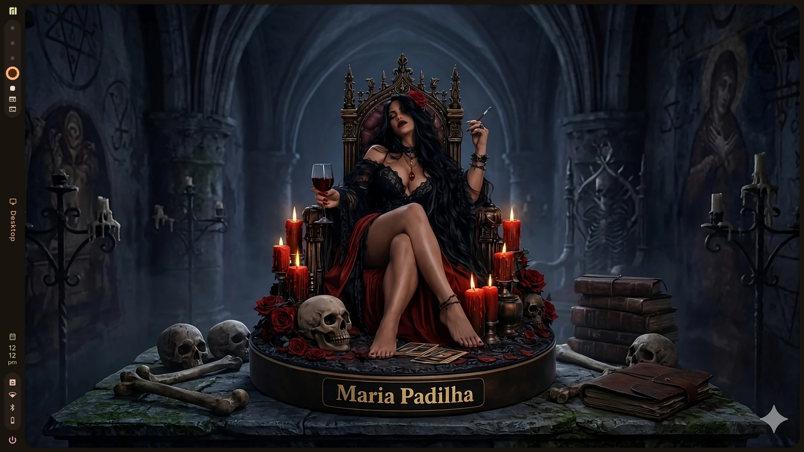
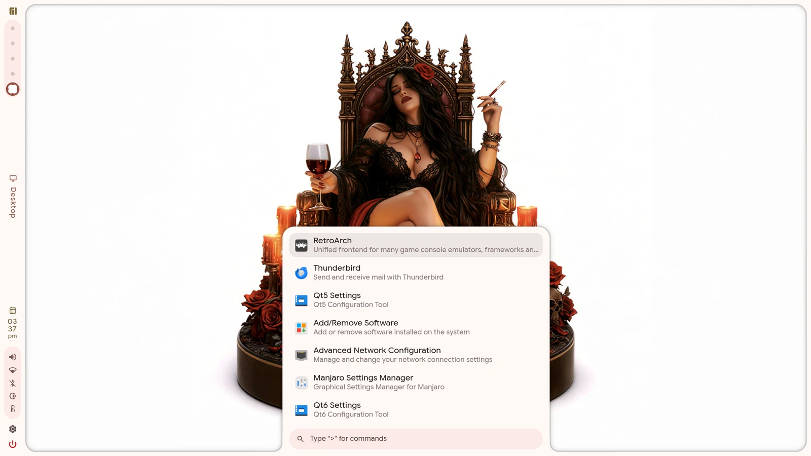
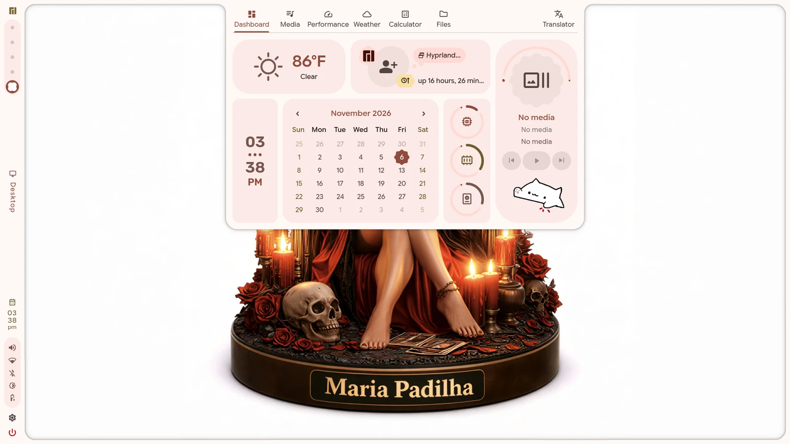
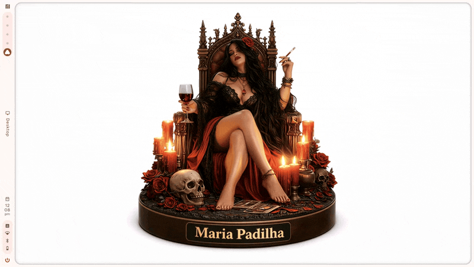

# Maria Padilha

Maria Padilha is a Wayland desktop environment built on
[Hyprland](https://hyprland.org) and [Quickshell](https://quickshell.org). It
provides a complete shell, a login session, a wallpaper-driven colour system,
and a Lua configuration layer.

[](https://github.com/maria-padilha-os/maria-padilha-de/actions/workflows/tests.yml)
[](https://github.com/maria-padilha-os/maria-padilha-de/releases/latest)

The name comes from Maria Padilha, a figure in Brazilian folk religion.

> **Status:** early development (0.2.x). The shell, session, theme engine, and
> package are usable; the settings application and greeter integration are
> still in progress.

## Install

Two profiles: `--full` installs the desktop session, shell, commands, and
configs; `--rice` keeps your current Hyprland session and installs the shell,
theme, and Hyprland config only.

```sh
mkdir -p ~/Códigos
git clone https://github.com/maria-padilha-os/maria-padilha-de.git \
    ~/Códigos/maria-padilha-de
cd ~/Códigos/maria-padilha-de

./install.sh --dry-run --full
./install.sh --full   # or --rice
```

The checkout is named `maria-padilha-de`, matching the repository under the
`maria-padilha-os` organization.

See [INSTALL.md](INSTALL.md) for the detailed guide, package install, uninstall,
and troubleshooting.

## Screenshots

| Day | Night |
| --- | --- |
|  |  |
|  |  |



The night image is the night palette preview, captured by switching the
wallpaper and palette; it is not a separate theme. The GIF is generated from
those two stills. More views are in the [gallery](docs/screenshots.md).

## Features

- **Shell** — bar, launcher, notifications, on-screen display, dashboard, and
  the panels around them.
- **Locking** — `padilha-lock` runs `hyprlock` in its own process, so a locker
  fault cannot take the shell and the session with it. The in-shell lock is
  opt-in.
- **Colour** — a wallpaper is scored into a Material You palette and written to
  Hyprland, GTK 3/4, Qt/Kvantum, terminals, btop, cava, fuzzel, spicetify,
  Neovim, Discord, and Midnight Commander.
- **Daylight** — a light wallpaper for the day and a dark one for the night,
  with the palette reapplied when the period changes.
- **Calculator** — type `>calc 2+2` in the launcher; the native `Qalculator`
  binding uses libqalculate for units, currency, variables, and exact results.
  `XF86Calculator` opens galculator, and `qalc -i` in a terminal gives the full
  REPL.
- **Configuration** — `init.lua` is compiled into the shell's JSON and
  validated against the shell's own schema. A generated `ui.lua` carries
  changes made from the settings UI.
- **Session** — a Wayland session entry, `padilha-session`, optional systemd
  user units, and opt-in window restore.
- **Packaging** — a PKGBUILD that installs the shell, commands, session units,
  and the greeter entry.

The shell is a fork of [Caelestia](https://github.com/caelestia-dots/shell)
2.5.0, adapted to this desktop.

## Requirements

Maria Padilha is packaged for Arch Linux and Arch-based distributions such as
Manjaro. It requires:

- Hyprland and Quickshell
- `hyprlock` for screen locking (installed by `install.sh --full`; an
  opt-in/recommended package dependency)
- Qt 6 (`qt6-base`, `qt6-declarative`)
- PipeWire, aubio, libcava, libqalculate, and lm_sensors
- Lua, ImageMagick, and `jq`
- the session daemons: `hypridle`, `hyprsunset`, `gnome-keyring`,
  `polkit-gnome`, `trash-cli`, and `bluez-utils`

Building additionally needs CMake, Ninja, Python 3, and a C++ toolchain.
Optional tools enable screenshots, recording, the pickers, and the Discord
theme; see `packaging/PKGBUILD`.

## Building

```sh
tools/build.sh
```

The script configures `shell/` with CMake and Ninja and writes the build tree
to `build/`. Because this tree is a snapshot without upstream commit history,
the version and revision are passed explicitly from `upstream.json`.

## Running

### From a checkout

From the repository root, inside a Hyprland session:

```sh
tools/build.sh
mkdir -p ~/.config/quickshell
ln -sfn "$PWD/shell" ~/.config/quickshell/caelestia
export QML2_IMPORT_PATH="$PWD/build/qml"
export PATH="$PWD/bin:$PATH"
padilha-session
```

Quickshell loads the shell through `~/.config/quickshell/caelestia`, and the
C++ modules come from `build/qml`. `padilha-session` compiles the configuration,
applies the current wallpaper's palette, and starts the shell.

### From the package

```sh
tools/release.sh
sudo pacman -U packaging/maria-padilha-<version>-1-x86_64.pkg.tar.zst
```

Then choose **Maria Padilha** at the display manager. The package installs the shell
to `/etc/xdg/quickshell/caelestia`, the commands to `/usr/lib/maria-padilha` with
links in `/usr/bin`, the session entry to `/usr/share/wayland-sessions`, and
the optional user units to `/usr/lib/systemd/user`.

## Configuration

User configuration lives in `~/.config/padilha/`:

| file | role |
| --- | --- |
| `init.lua` | the main configuration |
| `local.lua` | per-machine overrides, wins over `init.lua` |
| `ui.lua` | generated by `padilha-config` and the settings UI |

```lua
-- ~/.config/padilha/init.lua
return {
    appearance = {
        transparency = { enabled = false },
    },
    general = {
        idle = { timeouts = padilha.array {} },
    },
}
```

`padilha-config compile` validates the file against the shell's schema and
writes `~/.config/padilha/shell.json`. Apply a change with:

```sh
padilha-config compile && padilha-reload
```

See [CONFIG.md](CONFIG.md) for the precedence rules, the supported keys, and
`padilha-config set` / `unset`.

## Commands

| command | purpose |
| --- | --- |
| `padilha` | small command surface for keybinds (wallpaper, scheme, `doctor`) |
| `padilha-config` | compile the Lua configuration; `set`, `unset`, `capture` |
| `padilha-session` | compile, paint the palette, and start the shell |
| `padilha-lock` | lock through `hyprlock` in its own process |
| `padilha-shell-watch` | restart the shell after a crash (bounded backoff) |
| `padilha-brightness` | day/night panel brightness, with a manual hold |
| `padilha-theme` | render a wallpaper's palette into application configs |
| `padilha-daylight` | switch the wallpaper and palette by time of day |
| `padilha-reload` | restart the shell safely |
| `padilha-shot` | screenshots |
| `padilha-record` | screen recording |
| `padilha-clipboard` | clipboard history picker |
| `padilha-emoji` | emoji and glyph picker |

## Project layout

| path | contents |
| --- | --- |
| `shell/` | the shell: QML and a C++ plugin |
| `bin/` | the commands above |
| `lib/` | Lua modules behind the theme engine |
| `share/` | templates, wallpapers, theme defaults, and emoji data |
| `session/` | session entry, systemd user units, and window restore |
| `packaging/` | PKGBUILD and packaging notes |
| `tests/` | contract tests for the compiler, theme, and commands |
| `tools/` | build, release, and upstream-watch scripts |
| `examples/` | a reference `init.lua` |

## Documentation

- [Docs site](https://maria-padilha-os.github.io/maria-padilha-de/) — the published
  GitHub Pages site
- [INSTALL.md](INSTALL.md) — installation, profiles, uninstall, troubleshooting
- [DEPLOY.md](DEPLOY.md) — release readiness and rollback (deployment on hold)
- [CHANGELOG.md](CHANGELOG.md) — what changed and the known issues
- [docs/](docs/) — the GitHub Pages source: install, desktop, dotfiles, support
- [SUPPORT.md](SUPPORT.md) — optional donations and other ways to help
- [CONTRIBUTING.md](CONTRIBUTING.md) — development loop and pull-request rules
- [SECURITY.md](SECURITY.md) — private vulnerability reporting
- [ARCHITECTURE.md](ARCHITECTURE.md) — how the layers fit together
- [CONFIG.md](CONFIG.md) — the configuration contract
- [dotfiles](https://github.com/maria-padilha-os/maria-padilha-dotfiles) — the Hyprland, nvim and wezterm configs
- [KEYBINDS.md](KEYBINDS.md) — the keyboard map, including the vim layer
- [UPSTREAM.md](UPSTREAM.md) — the projects Maria Padilha tracks and how updates are absorbed
- [session/README.md](session/README.md) — session, systemd units, and restore
- [packaging/README.md](packaging/README.md) — checkout versus package

## Development

```sh
tests/all.sh
```

The suite covers the configuration compiler, the colour maths against
Material's reference implementation, and the command-line contracts. CI runs
the same suite on Arch for every push and pull request.

## License

Maria Padilha is distributed under the GNU General Public License, version 3 only.
See [LICENSE](LICENSE) for the full text.

The shell in `shell/` is a fork of Caelestia v2.5.0 and keeps its GPL-3.0
license; see [shell/LICENSE](shell/LICENSE).
