# Widget design checklist

Use this when adding or changing a dashboard tab or bar widget. The goal is a
panel that still reads well when the dashboard is narrow, when a service is
slow, and when the user is on a light or dark wallpaper.

## Layout

- Use `Tokens.padding.*` for the outer edge and `Tokens.spacing.*` between
  groups. Do not add one-off pixel padding in a widget.
- Use `Tokens.rounding.*` for cards, fields and buttons. Match the radius of
  neighbouring cards instead of inventing a larger one.
- Declare `minimumWidth` and `minimumHeight` in the tab root (and mirror them
  in the widget). The dashboard clamps to them before the content is created.
- Keep primary actions inside the panel at the minimum size; let secondary
  detail columns hide or elide before the main label is squeezed.
- Cap long lists with a scroll area or `ListView`; never let results or menu
  rows push the footer off the panel.

## Typography

- Use `Tokens.font.*` builders for every label, value and icon. No
  `font.pixelSize`, `font.family: "monospace"`, or hand-written point sizes.
- Elide one-line labels with `Text.ElideRight` (or `ElideMiddle` for paths) and
  add a tooltip when the full value matters.
- Wrap descriptions and error messages, and set a sensible maximum line count.

## Colour and states

- Take colours from the shared palette (`Colours` in the shell, `api.colours`
  in an extension). No hex values or CSS colour names.
- Derive hover, focus and disabled states from the palette instead of
  `Qt.lighter` or a second hard-coded colour.
- Give text fields and custom buttons a visible keyboard focus ring, and make
  Space/Return activate the focused control.
- Always design the empty, loading and error states. Do not leave a blank
  rectangle where a service is still loading.
- Keep network, audio and timer work behind `active`, and stop it when the tab
  is not selected.

## Before merging

- [ ] The tab loads under `tests/extensions/run.sh` (or the matching dashboard
      test) without QML warnings.
- [ ] `minimumWidth <= implicitWidth` and `minimumHeight <= implicitHeight`.
- [ ] A long label elides, and the footer/actions stay inside the panel at the
      minimum size.
- [ ] Empty, loading and error states have been looked at, not just the happy
      path.
- [ ] `bash tests/all.sh` and `make lint` pass.
- [ ] Screenshots are captured on an empty workspace, never with a terminal,
      browser, private window, or live notification visible.

## Before and after

These captures use the offscreen harness in `tools/widget-screenshots.sh`: a
throwaway `HOME`, an empty temporary folder for Files, `active: false`
everywhere, and a fixed Material dark palette. They do not capture the live
desktop.

| | Before | After |
| --- | --- | --- |
| Calculator | 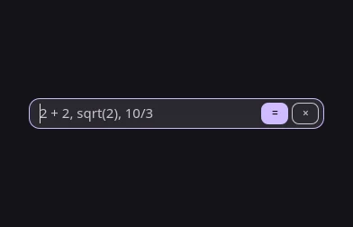 | 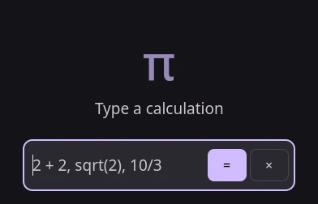 |
| Files | 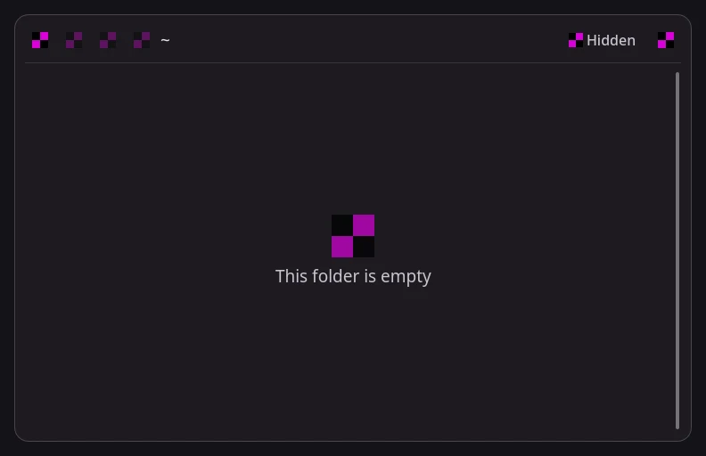 | 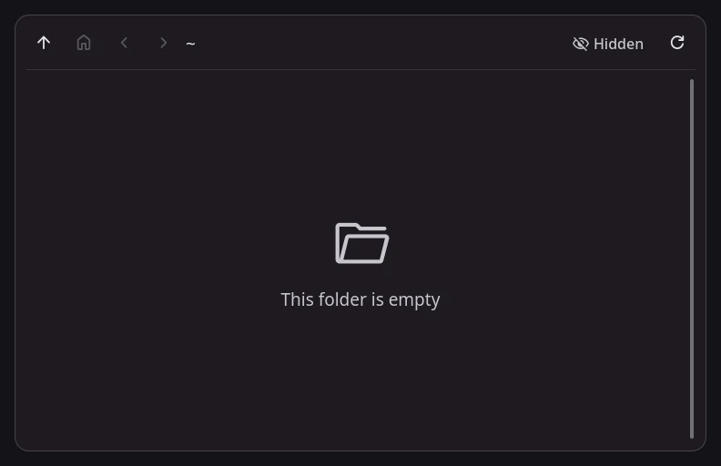 |
| Maps |  | 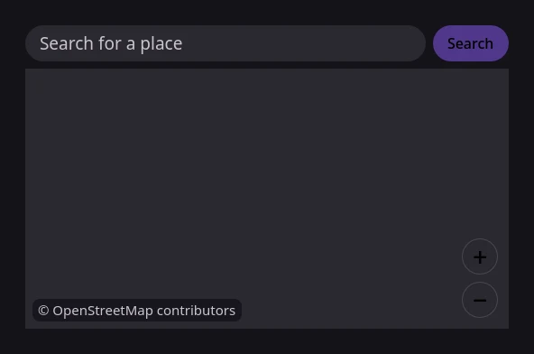 |
| Stopwatch | 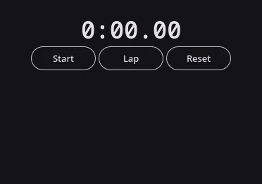 | 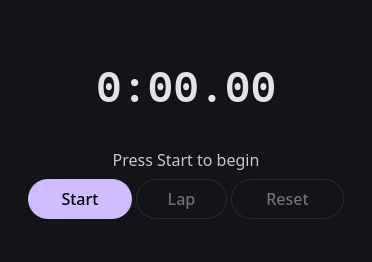 |
| Translator | 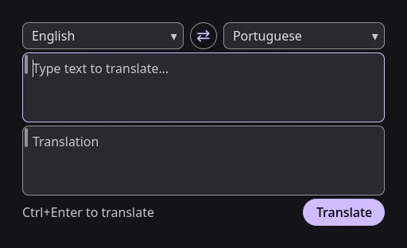 | 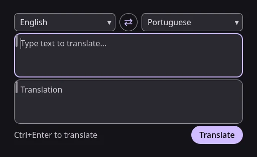 |
| Tuner | 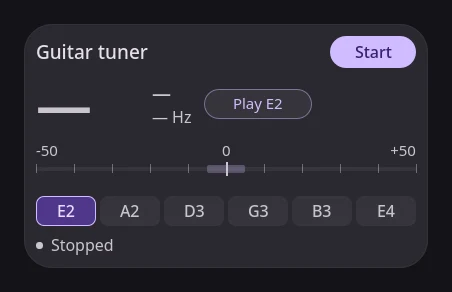 | 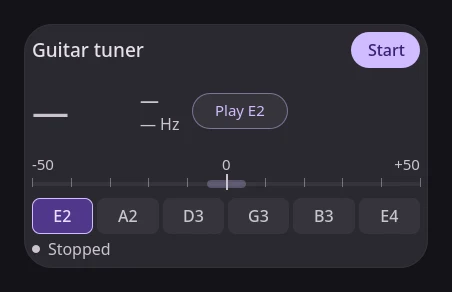 |

Regenerate the after captures with:

```sh
tools/widget-screenshots.sh --out .scratch/widget-screenshots
```
