# Screenshots and demo

The day and night palettes are generated from the wallpaper. The night view is
the night-palette preview after switching the wallpaper and palette; it is not a
separate theme. These clips were assembled from stills captured on an empty
workspace, not recorded from a live desktop.

## Demo

<video controls loop muted playsinline poster="assets/screenshots/desktop-day.webp">
  <source src="assets/demo/tour.mp4" type="video/mp4">
  Your browser does not support the video element.
</video>

The MP4 is a short slideshow of the same stills; it is not a screen recording.

## Deskbar widgets

Hover the status icons in the bar to open the widgets:

| Audio | Display |
| --- | --- |
| 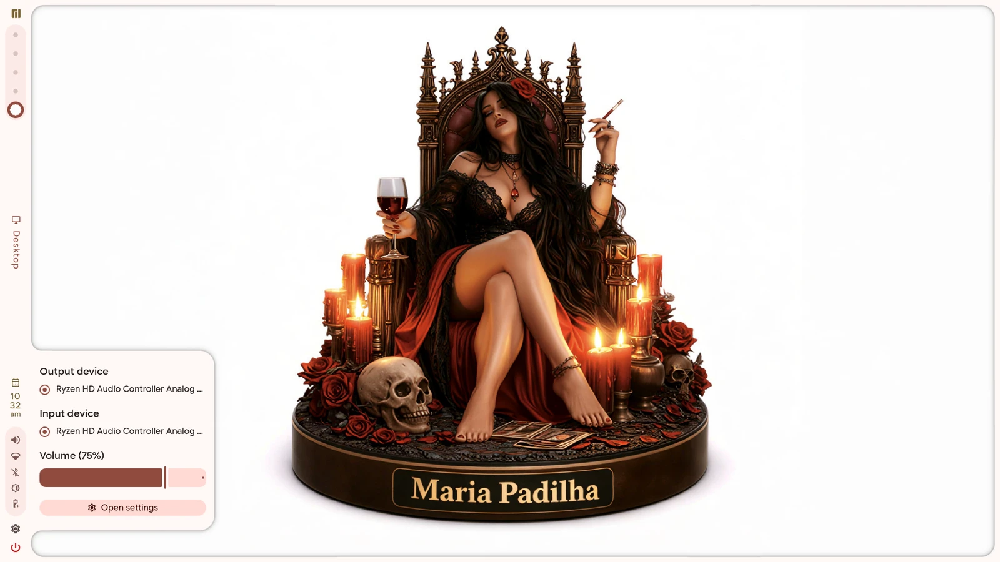 | 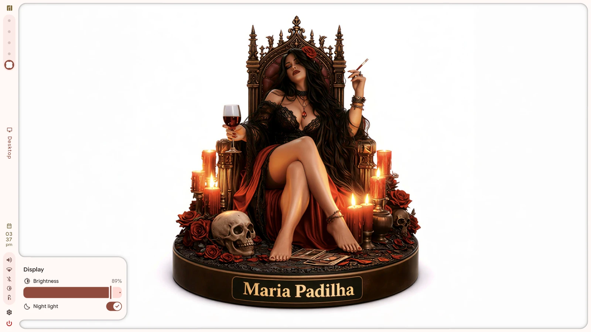 |

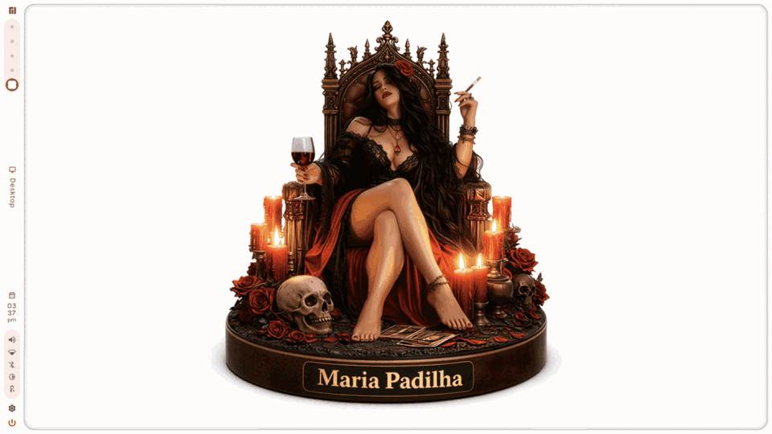

<video controls loop muted playsinline poster="assets/screenshots/bar-audio.webp">
  <source src="assets/demo/widgets.mp4" type="video/mp4">
  Your browser does not support the video element.
</video>

## Dashboard tabs

| Dashboard | Media |
| --- | --- |
| 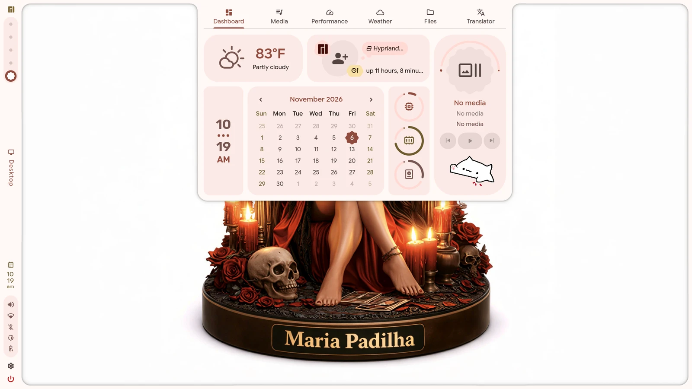 | 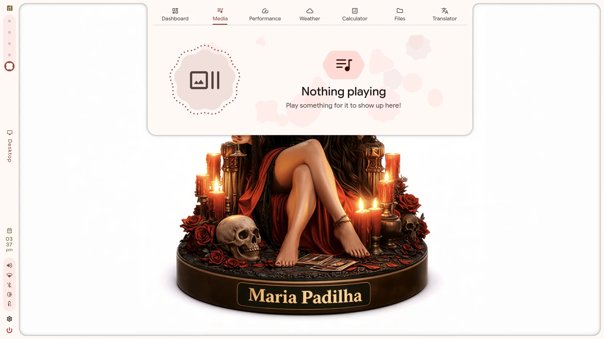 |

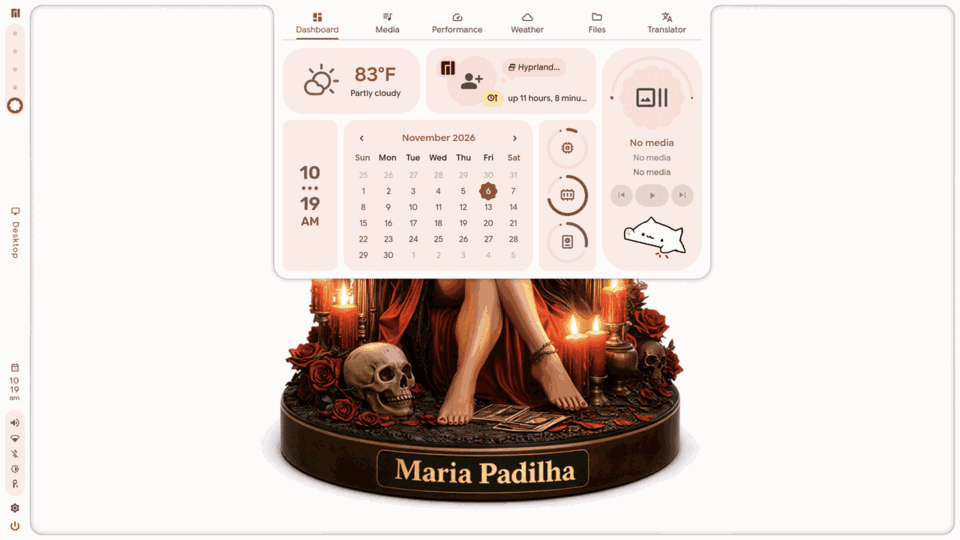

<video controls loop muted playsinline poster="assets/screenshots/tabs/dashboard.webp">
  <source src="assets/demo/tabs.mp4" type="video/mp4">
  Your browser does not support the video element.
</video>

| Performance |
| --- |
| 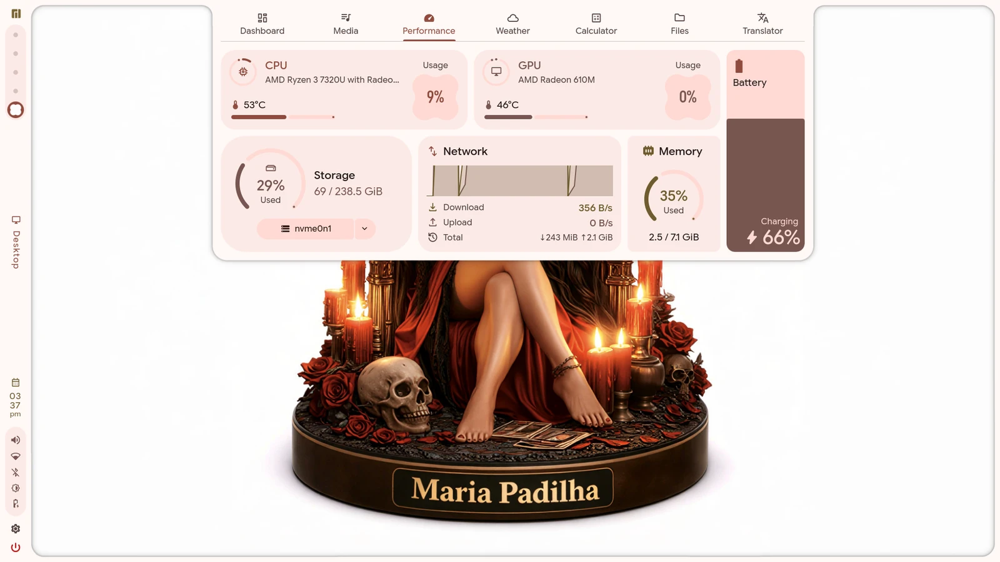 |

## Launcher

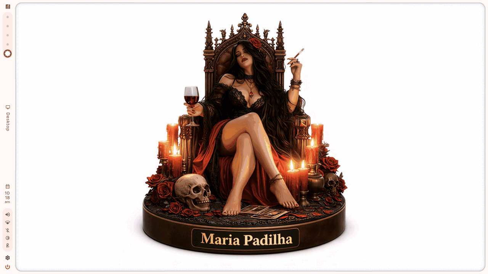

The launcher is part of the shell (not fuzzel); its colours come from the same
wallpaper-derived palette as the bar and the applications.

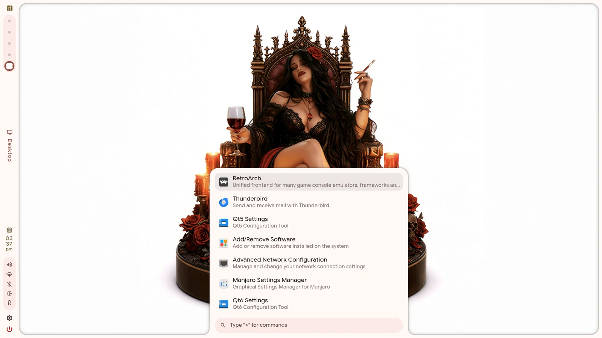

## Dashboard

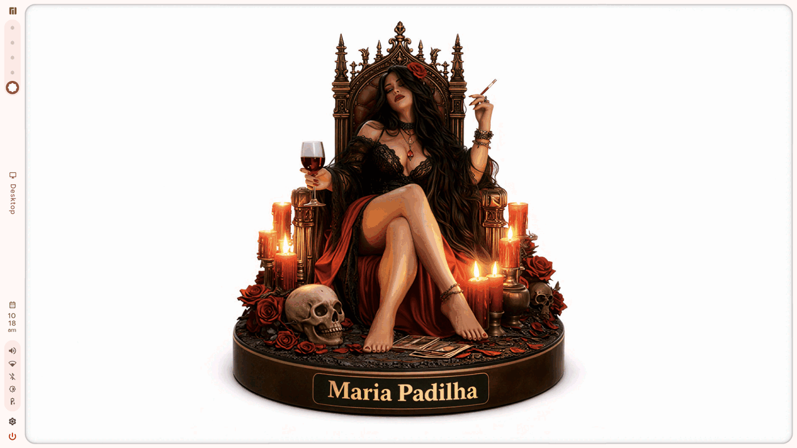

The dashboard, media, performance, and weather panels are Quickshell surfaces
painted from the active palette.

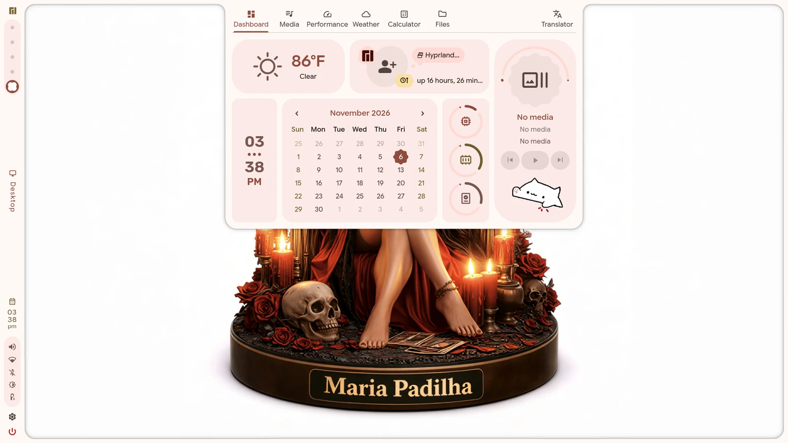

## Day and night

| Day | Night |
| --- | --- |
|  | 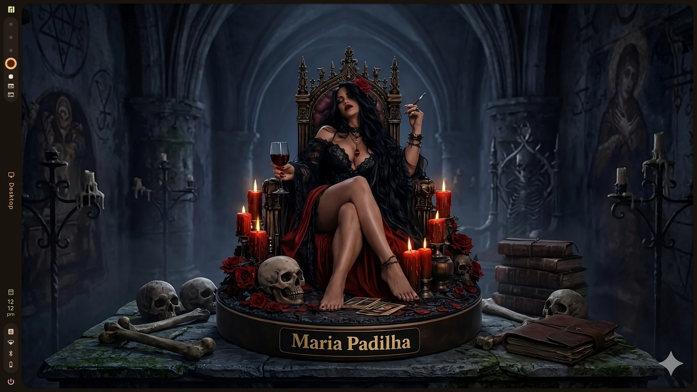 |

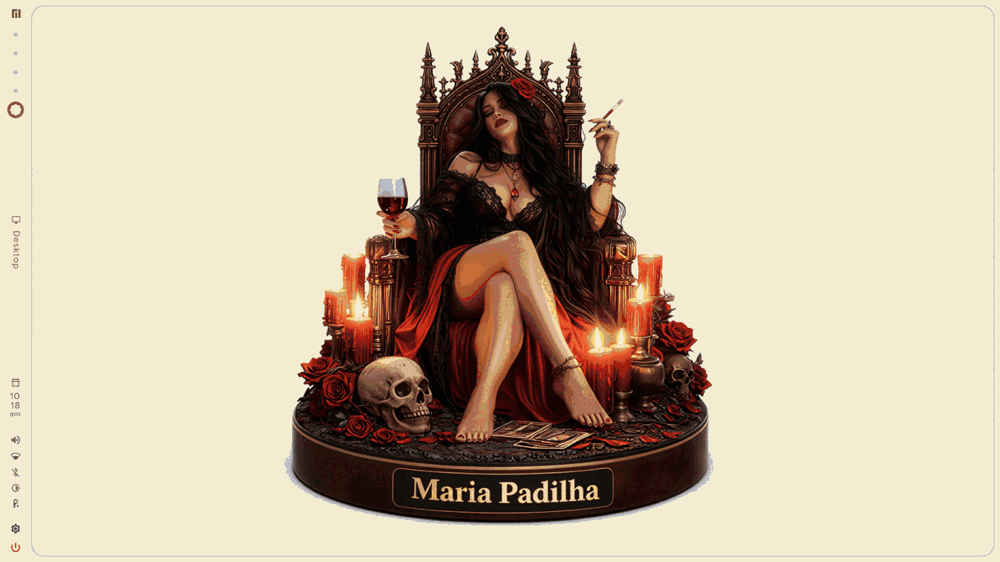

